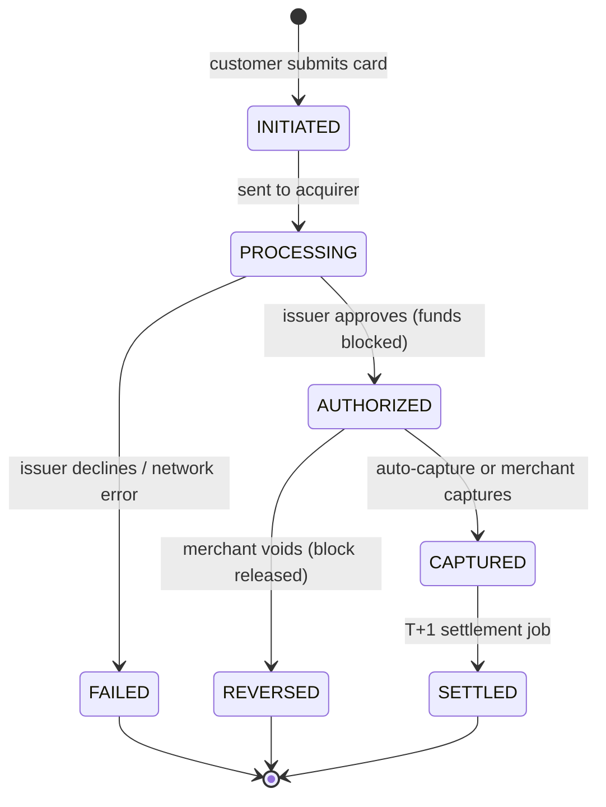
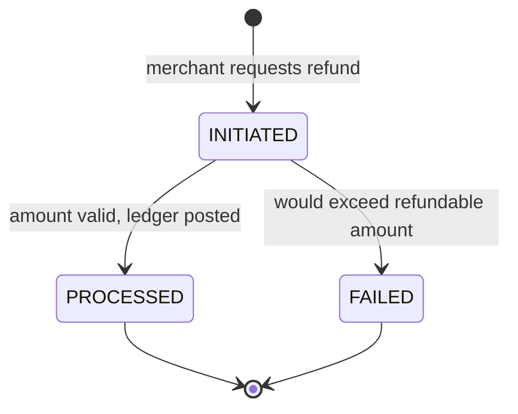
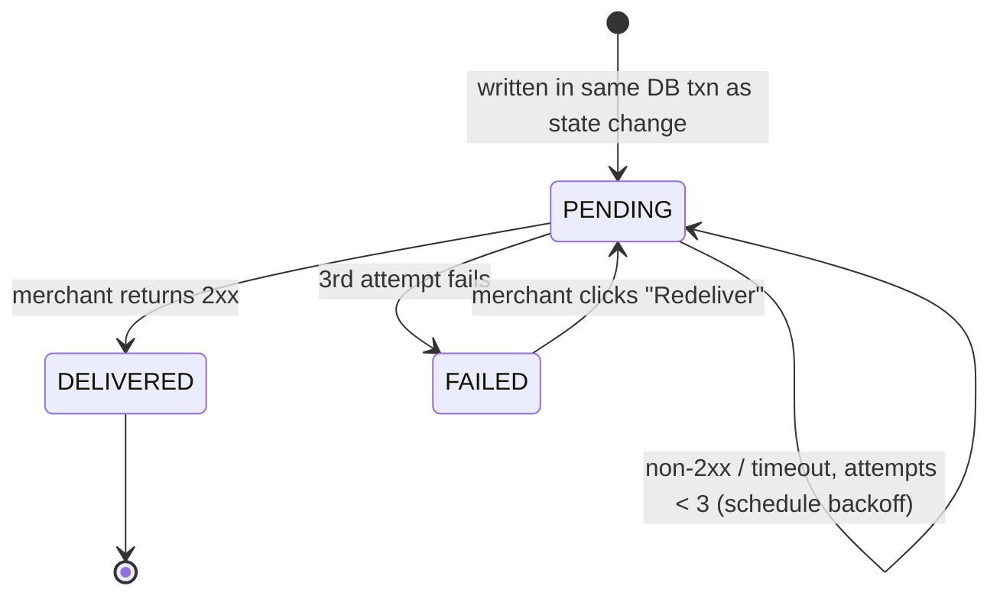
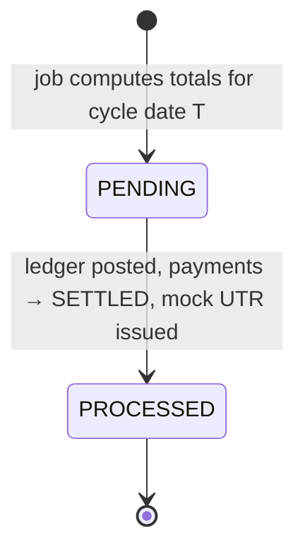

# State Machines

Rule: a state change is only allowed if the edge is in the table below.
Every change = one DB transaction that (1) updates the row, (2) inserts a
`payment_events` row, (3) inserts a `webhook_events` row (outbox). All or nothing.

## 1. Payment (one card attempt)



| From | To | Trigger | Webhook event |
|---|---|---|---|
| — | INITIATED | `POST /pay/{slug}/attempts` | — |
| INITIATED | PROCESSING | simulator picks it up | — |
| PROCESSING | AUTHORIZED | issuer approves | `payment.authorized` |
| PROCESSING | FAILED | issuer declines / network error | `payment.failed` |
| AUTHORIZED | CAPTURED | auto (default) or `POST /v1/payments/{id}/capture` | `payment.captured` |
| AUTHORIZED | REVERSED | `POST /v1/payments/{id}/void` | `payment.reversed` |
| CAPTURED | SETTLED | settlement job | (covered by `settlement.processed`) |

Refunds do **not** change payment status. A payment shows `refunded_paise`
(sum of processed refunds) instead — so "partially refunded" is derived, not a state.

### Simulated 4-party flow (logged as `payment_events.hop`)
```
Customer → PayFlow (PG) → Acquiring Bank → Card Network (Visa if BIN starts 4, Mastercard if 5) → Issuing Bank
                                                                                                   │ decision
Customer ← PayFlow (PG) ← Acquiring Bank ← Card Network ←──────────────────────────────────────────┘
```

### Test cards (issuer decides)
| Card | Result | failure_code |
|---|---|---|
| 4242 4242 4242 4242 | Approved | — |
| 5555 5555 5555 4444 | Approved (Mastercard) | — |
| 4000 0000 0000 0002 | Declined | `card_declined` |
| 4000 0000 0000 9995 | Declined | `insufficient_funds` |
| 4000 0000 0000 0119 | Network timeout | `network_error` |
| Fails Luhn check | Rejected at checkout, no payment created | — |

## 2. Refund


Allowed only on payments in `CAPTURED` or `SETTLED`. Event: `refund.processed` / `refund.failed`.

## 3. Webhook event (outbox)


Each attempt is a row in `webhook_deliveries` (status code, latency, error).

## 4. Settlement


Unique on `(merchant_id, cycle_date)` → running the job twice is safe (idempotent).

## 5. Payment link
`ACTIVE → PAID` (first captured payment) · `ACTIVE → EXPIRED` (after `expires_at`).
